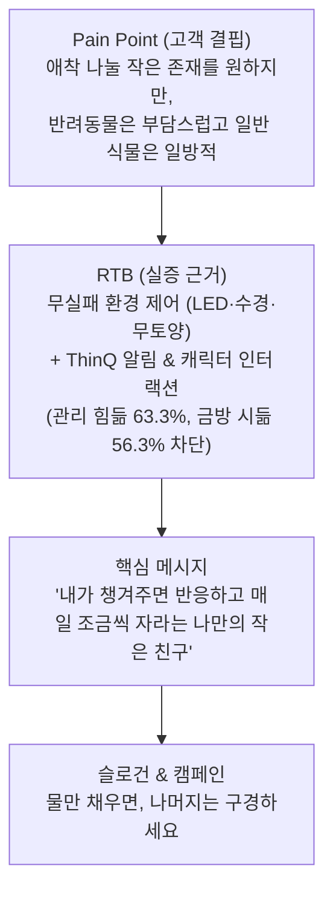

# 🌱 LG 틔운 미니 × ThinQ 새싹이 다마고치 인스타그램 랜딩페이지

> **슬로건**: **"물만 채우면, 나머지는 구경하세요"**  
> **캠페인 컨셉**: **"마음만 먹고 미뤄온 첫 반려식물 — 손은 가볍게, 지켜보는 재미는 매일"**  
> **핵심 메시지**: *"반려동물은 아직 부담스럽지만, 내가 챙겨주면 반응하고 매일 조금씩 자라는 나만의 작은 친구가 있었으면 좋겠어."*

---

## 🎯 프로젝트 기획 개요 및 배경

본 프로젝트는 단순한 가전 판매 페이지가 아닌, **2030 1인 가구 및 초보 식집사의 정서적 결핍을 해소하는 '교감형 반려식물 메이트'** 캠페인 랜딩페이지입니다.

---

## 📱 주요 구현 기능 및 섹션

### 1. ★ [와우 인터랙션] ThinQ 다마고치 가상 새싹이 시뮬레이터
- 스마트폰 목업 속 귀여운 아기 새싹 캐릭터와 실시간 상호작용:
  - **목마름 상태**: 저녁 9시 "나 목말라 물줘!~ 💧" 알림과 땀 흘리는 표정
  - **물 채워주기 클릭**: 하트 파티클 효과 + 만세 점프 애니메이션 + `"물을 줘서 고마워요! 오늘도 조금 자랐어요🌱"`
  - **쓰다듬기 터치**: `"간질간질~ 주인님 사랑해요! 💚"` 애착도 상승
  - **성장 단계 4단계 진화**: `[1. 씨앗]` ➔ `[2. 새싹]` ➔ `[3. 잎]` ➔ `[4. 꽃]`
- 모든 캐릭터 인터랙션은 **GA4 이벤트로 실시간 추적**됩니다.

### 2. AIDA 기반 고전환 섹션 구성
1. **Hero**: 감성 헤드라인("물만 채우면, 나머지는 구경하세요") + LG 틔운 미니 실물 & ThinQ 캐릭터 듀얼 렌더링 + 조명 모드 체험 + 199,000원 특가 혜택
2. **Campaign Logic (Pain ➔ RTB ➔ Message)**: 슬라이드 1 기획 데이터 완벽 시각화
3. **하루 일과 속 한 장면**: *"저녁 9시, ThinQ 앱에 '새싹이가 목이 말라요!' 알림. 물을 채우면 화면 속 캐릭터가 기뻐하고, 며칠 전보다 커진 잎을 기록한다."*
4. **무실패 환경 제어 3대 기술**: 18W 생장 LED, 스마트 물 수위 부표, 흙 없는 무벌레 올인원 배지
5. **씨앗 키트 셀렉터**: 홈카페 허브 / 신선 샐러드 / 화사한 꽃 탭별 실시간 선택 인터랙션
6. **인테리어 갤러리**: 서재 데스크테리어, 침실 무드등
7. **스펙 & FAQ**: 제품 규격 및 초보자 의구심 완전 해소
8. **엄지손가락 스티키 바**: 인스타 브라우저 어디서든 원클릭 공식몰 이동
9. **GA4 실시간 트래커 콘솔**: 우측 상단 `GA4` 버튼 클릭 시 모든 이벤트 실시간 모니터링

---

## 📊 GA4 수집 이벤트 명세표 (캐릭터 인터랙션 포함)

| 이벤트명 (`Event Name`) | 발화 시점 | 주요 매개변수 | 비즈니스 가치 |
| :--- | :--- | :--- | :--- |
| **`interact_character_water`** | 시뮬레이터에서 물주기/쓰다듬기 클릭 시 | `action: 'give_water'\|'tap_character'`, `mood_after: 'happy'` | **캐릭터 기능에 대한 정서적 인게이지먼트 측정** |
| **`view_character_stage`** | 1단계~4단계 진화 탭 클릭 시 | `stage_name`, `stage_level: 'seed'\|'sprout'\|'leaf'\|'bloom'` | 캐릭터 육성 기능 관심도 분석 |
| **`click_cta`** | '내 첫 초록 메이트 입양하러 가기' 클릭 시 | `cta_location`, `item_id: 'L023E1P42'`, `price: 199000` | **공식몰 최종 구매 전환 (Macro Conversion)** |
| **`begin_checkout`** | 구매 버튼 클릭 시 동시 발화 | `currency: 'KRW'`, `value: 199000`, `items` | GA4 전자상거래 표준 퍼널 보고서 |
| **`scroll_depth`** | 스크롤 25%, 50%, 75%, 90%, 100% | `percent_scrolled`, `page_location` | 상세페이지 탐색 깊이 측정 |
| **`select_seed_kit`** | 씨앗 키트 패키지 카드 클릭 시 | `kit_name`, `kit_type`, `estimated_days` | 선호 식물군 파악 |
| **`interact_light_feature`** | 생장 모드 vs 감성 무드등 스위칭 | `light_mode`, `brightness` | 하드웨어 기능 인터랙션 추적 |
| **`faq_interaction`** | FAQ 질문 펼침/접힘 | `faq_question`, `action: 'open'\|'close'` | 구매 전 고객 의구심 요인 분석 |
| **`share`** | 공유하기 클릭 시 | `method: 'copy_link'\|'native_share'` | 오가닉 바이럴 확산 측정 |

---

## 🚀 로컬 접속 및 실시간 테스트

로컬 웹 서버가 포트 `8089`에서 실행 중입니다:

👉 **[http://localhost:8089/?utm_source=instagram&utm_medium=bio_link&utm_campaign=tamagotchi_sprout](http://localhost:8089/?utm_source=instagram&utm_medium=bio_link&utm_campaign=tamagotchi_sprout)**

1. 접속 후 우측 상단의 **`GA4`** 버튼을 클릭하여 드로어를 엽니다.
2. 페이지를 스크롤하여 **'ThinQ 가상 새싹이 체험'** 섹션으로 이동합니다.
3. **[물 가득 채워주기 💧]** 버튼을 누르면 새싹이가 하트를 띄우며 기뻐하고, 상단 GA4 콘솔에 `interact_character_water` 이벤트가 실시간으로 기록되는 것을 확인하실 수 있습니다.
